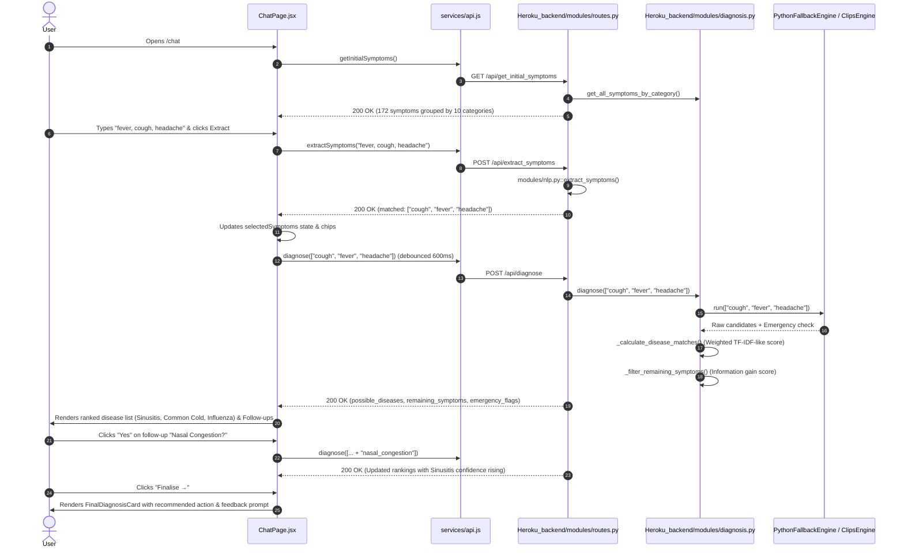

# AI Disease Diagnosis Expert System — Technical & Architectural Documentation

> **Status:** Academic Demonstration & Educational Prototype  
> **Notice:** This document accurately describes the current codebase as implemented. It explicitly identifies what is fully functional, what is handled in Python vs. CLIPS, and where UI/backend gaps exist.

---

## PART A: What the Website Does (End to End)

### 1. Functionality List

| Feature | Status | Description |
| :--- | :--- | :--- |
| **Home Page (`/`)** | **WORKING** | Displays hero introduction, feature highlights, 4-step workflow overview, and a CTA button routing to the diagnostic chat. |
| **Diagnose / Chat Page (`/chat`)** | **WORKING** | Two-column layout hosting symptom selection, free-text extraction, real-time ranked differential diagnosis, and follow-up inquiry. |
| **History Page (`/history`)** | **WORKING** | Lists past completed diagnostic sessions saved locally with timestamps, matched diseases, confidence scores, and individual/global deletion. |
| **About Page (`/about`)** | **NOT IMPLEMENTED** | No route, view component, or navigation link exists in the frontend for an About page. |
| **Symptom Category Selection** | **WORKING** | Groups 172 symptoms across 10 categories (Common, Respiratory, Digestive, etc.) in filterable tab buttons inside `SymptomSelector.jsx`. |
| **Symptom Search** | **WORKING** | Instant client-side text filtering over symptom names and human-readable labels inside `SymptomSelector.jsx`. |
| **Free-Text Symptom Input** | **WORKING** | Input field calls `/api/extract_symptoms` using dictionary lookup and negation checking to extract canonical symptom IDs. |
| **Selected Symptom Chips** | **WORKING** | Removable pill badges (`SelectedSymptomsBar.jsx`) displaying currently asserted symptoms with immediate single-click removal. |
| **Live Ranked Diseases Panel** | **WORKING** | As symptoms change, debounced requests re-rank candidates in real time with visual percentage bars and High/Moderate/Low confidence tags. |
| **Follow-up Questions** | **WORKING** | Sidebar suggests top unselected symptoms calculated by information gain, offering interactive "Yes" (asserts) / "No" (dismisses) buttons. |
| **Final Diagnosis Card** | **WORKING** | Deep-dive summary card presenting disease description, matched vs. missing symptoms, recommended actions, and supportive remedies. |
| **Emergency / Safety Alert** | **WORKING** | Red warning banner triggered when critical symptom combinations (cardiac, stroke, meningitis, anaphylaxis, GI bleed, etc.) are detected. |
| **Diagnosis Feedback** | **WORKING** | Form collecting user satisfaction (Yes/No), missed symptoms, and free-form notes, persisting entries directly to `backend/data/feedback.json`. |
| **Client-side Session Persistence** | **WORKING** | Active consultation state (symptoms, candidates, follow-ups) persists across browser refreshes via `localStorage` (`diagnosis_active_session`). |
| **Permanent Medical Disclaimer** | **WORKING** | High-visibility yellow banner persistently displayed across all application routes via `DisclaimerBanner.jsx`. |
| **CSV Knowledge Base Upload** | **PARTIAL** | Backend endpoint (`POST /api/upload_csv`) and CSV template generator (`GET /api/upload_csv/template`) exist, but no frontend upload UI is implemented. |
| **Knowledge Base REST Management** | **PARTIAL** | Backend endpoints exist for CRUD operations on diseases/symptoms (`/api/knowledge/*`), but no administrative frontend UI is connected. |

---

### 2. User Journey (Step-by-Step Walkthrough)

**Scenario:** A user experiences fever, cough, and headache and uses the system to evaluate symptoms.



#### Step Breakdown
1. **Initial Load:**
   - **Frontend Component:** `ChatPage.jsx` mount hook calls `getInitialSymptoms()` from `services/api.js`.
   - **API Request:** `GET /api/get_initial_symptoms`.
   - **Backend Handler:** `modules/routes.py::get_initial_symptoms()`.
   - **Payload Returned:** JSON map of 10 categories containing 172 symptom names and display titles.
2. **Text Input & Extraction:**
   - **Frontend Component:** Free-text box in `ChatPage.jsx`. User enters `"fever, cough, headache"`.
   - **API Request:** `POST /api/extract_symptoms` with `{"text": "fever, cough, headache"}`.
   - **Backend Handler:** `modules/routes.py::extract_symptoms_endpoint()` calls `modules/nlp.py::extract_symptoms()`.
   - **Payload Returned:** `{"matched": ["cough", "fever", "headache"], "unrecognized": [...]}`.
3. **Live Inference:**
   - **Frontend Component:** `SelectedSymptomsBar.jsx` renders chips; debounced hook in `ChatPage.jsx` triggers inference.
   - **API Request:** `POST /api/diagnose` with `{"symptoms": ["cough", "fever", "headache"]}`.
   - **Backend Handler:** `modules/routes.py::diagnose()` invokes `DiagnosisEngine.diagnose()`.
   - **Processing:** Rule engine returns candidate matches. Python calculates weighted inverse-frequency confidence scores and evaluates remaining symptoms by entropy/information gain.
   - **Payload Returned:** JSON with `possible_diseases` (Sinusitis top, followed by Chickenpox, Malaria, Influenza), `remaining_symptoms` (Nausea, Fatigue, Muscle Pain), `emergency_flags: []`, and disclaimer.
4. **Follow-Up Questioning:**
   - **Frontend Component:** Sidebar card `"❓ Follow-up Questions"`. User clicks "Yes" on `nasal_congestion`.
   - **Inference Cycle:** Symptom is appended to `selectedSymptoms`, re-triggering `POST /api/diagnose`. Sinusitis confidence rises from 22.5% to 47.1% (Moderate).
5. **Finalisation:**
   - **Frontend Component:** User clicks "Finalise →". `FinalDiagnosisCard.jsx` displays full clinical notes, self-care/consultation guidance, homeopathic options, and `DiagnosisFeedback.jsx`.
   - **Feedback Submission:** User rates satisfaction, specifies missed symptoms, and clicks "Submit Feedback".
   - **API Request:** `POST /api/feedback`.
   - **Backend Handler:** `modules/routes.py::submit_feedback()` appends entry to `backend/data/feedback.json`.

---

### 3. API Reference Table

| Method | Endpoint | Request Body | Response Shape | Invoked By |
| :--- | :--- | :--- | :--- | :--- |
| `GET` | `/api/health` | *None* | `{"status": "ok", "engine": string, "kb_version": string, "disease_count": int, "symptom_count": int, "timestamp": string}` | `services/api.js::healthCheck()` *(monitoring/smoke test)* |
| `GET` | `/api/get_initial_symptoms` | *None* | `{"categories": { "<category>": [{"name": string, "display_name": string}] }, "engine": string}` | `ChatPage.jsx` via `api.js::getInitialSymptoms()` |
| `GET` | `/api/symptoms` | Query params: `category`, `q`, `page`, `page_size` | `{"symptoms": [...], "total": int, "page": int, "page_size": int}` | Backend utility / test suite |
| `POST` | `/api/diagnose` | `{"symptoms": [string]}` | `{"possible_diseases": [...], "remaining_symptoms": [...], "final_diagnosis": object\|null, "emergency_flags": [...], "disclaimer": string, "next_steps": string, "engine": string, "response_time_ms": float}` | `ChatPage.jsx` via `api.js::diagnose()` |
| `POST` | `/api/extract_symptoms` | `{"text": string}` | `{"matched": [string], "unrecognized": [string]}` | `ChatPage.jsx` via `api.js::extractSymptoms()` |
| `POST` | `/api/feedback` | `{"session_id": string, "satisfied": bool, "final_disease": string, "missed_symptoms": [string], "comments": string}` | `{"status": "ok", "message": string}` (Status: `201 Created`) | `DiagnosisFeedback.jsx` via `api.js::submitFeedback()` |
| `GET` | `/api/diseases` | Query params: `q`, `category`, `page`, `page_size` | `{"diseases": [...], "total": int, "page": int, "page_size": int}` | `services/api.js::getDiseases()` |
| `GET` | `/api/diseases/<id>` | *None* | Disease entity JSON | Test suite |
| `POST` | `/api/upload_csv` | Multipart form data with key `'file'` (`.csv`) | `{"status": string, "added": [...], "updated": [...], "skipped": [...], "errors": [...], "summary": string}` | `services/api.js::uploadCSV()` *(backend ready, UI unlinked)* |
| `GET` | `/api/upload_csv/template` | *None* | CSV text file download | `services/api.js::getCSVTemplate()` |

---

### 4. Data Specification & Storage

- **Knowledge Base Scale:**
  - **Diseases:** 45 distinct conditions.
  - **Symptoms:** 172 normalized snake_case symptoms.
  - **Categories:** 10 diagnostic groupings (Common, Respiratory, Digestive, Neurological, Cardiovascular, Skin, Musculoskeletal, Urinary, Eye_ENT, General_Systemic).
- **Disease Entity Schema:**
  ```json
  {
    "id": "d001",
    "name": "Common Cold",
    "category": "Respiratory",
    "severity": "mild",
    "symptoms": ["runny_nose", "sneezing", "sore_throat", "cough", "nasal_congestion", "fatigue", "mild_fever"],
    "description": "A viral infectious disease of the upper respiratory tract...",
    "recommended_action": "self-care",
    "next_steps": "Rest, hydration, and over-the-counter cold remedies. Consult doctor if high fever lasts >3 days.",
    "homeopathic_remedies": ["Aconite 30C for early onset after cold exposure", "Allium Cepa 30C for profuse watery runny nose"],
    "remedies_disclaimer": "Homeopathic and traditional suggestions are complementary and educational only...",
    "icd10": "J00"
  }
  ```
- **Storage Locations:**
  - **Knowledge Base Source:** `Heroku_backend/data/knowledge_base.json`.
  - **Compiled Rules:** `Heroku_backend/data/disease-symptoms.clp`.
  - **User Feedback:** Appended to JSON file on disk at `Heroku_backend/data/feedback.json`.
  - **Diagnostic History:** Stored in the browser's `localStorage` under key `diagnosis_history` (persists up to 50 sessions).
  - **Active Session:** Stored in the browser's `localStorage` under key `diagnosis_active_session`.
  - **CSV Uploads:** Overwrites `knowledge_base.json` atomically, creates a versioned copy in `Heroku_backend/data/kb_versions/knowledge_base_<timestamp>.json`, and regenerates `disease-symptoms.clp`.

---

## PART B: How the Backend Works (Focus on CLIPS & Python Fallback)

### 5. Backend Architecture & Modules

```
                +---------------------------------------+
                |        React Client (Vite)            |
                |  ChatPage / HistoryPage / Feedback    |
                +---------------------------------------+
                                   |
                                   | HTTP REST (JSON)
                                   v
                +---------------------------------------+
                |         Flask REST API Layer          |
                |      Heroku_backend/app.py            |
                |    Heroku_backend/modules/routes.py   |
                +---------------------------------------+
                                   |
                                   v
                +---------------------------------------+
                |       DiagnosisEngine Coordinator     |
                |   Heroku_backend/modules/diagnosis.py |
                +---------------------------------------+
                     /                             \
     (CLIPS available)                     (CLIPS unavailable)
                   v                                 v
    +-----------------------------+   +-----------------------------+
    |        ClipsEngine          |   |     PythonFallbackEngine    |
    | modules/clips_engine.py     |   | modules/fallback_engine.py  |
    | (clipspy -> CLIPS C-library)|   | (Pure Python set matching)  |
    +-----------------------------+   +-----------------------------+
                   \                                 /
                    v                               v
             Raw Candidates & Emergency Flags Triggered
                                   |
                                   v
    +-------------------------------------------------------------+
    |             Python Post-Processing & Ranking                |
    |  - Inverse Document Frequency (IDF) symptom weighting       |
    |  - Normalized confidence calculations (0.0 to 1.0)          |
    |  - Candidate ranking & high-confidence labeling             |
    |  - Information Gain calculation for remaining symptoms      |
    +-------------------------------------------------------------+
```

#### Module Responsibilities
- `app.py`: Flask application factory. Manages CORS, triggers CLP generation on startup, and eagerly initializes the singleton diagnosis engine.
- `modules/routes.py`: Flask blueprint handling HTTP routing, input validation (e.g., maximum 50 symptoms, 2000 character limits for NLP), response timing, and JSON serialization.
- `modules/diagnosis.py`: High-level orchestrator singleton (`DiagnosisEngine`). Bridges Flask to the underlying inference engine, computes inverse frequency weights, calculates ranked confidence, and approximates information gain.
- `modules/clips_engine.py`: Wrapper interfacing with `clipspy`. Instantiates a new CLIPS environment per request, loads compiled `.clp` files, asserts facts, runs rule execution, and extracts candidate/emergency facts.
- `modules/fallback_engine.py`: Pure-Python forward-chaining simulation. Emulates CLIPS rule evaluations using Python sets and list comprehensions when `clipspy` is unavailable.
- `modules/safety.py`: Deterministic emergency rule definitions and medical disclaimer strings.
- `modules/nlp.py`: Lightweight text pre-processor. Uses n-gram scanning (1 to 5 words) against `data/synonyms.json` and accounts for basic preceding negation phrases ("no", "without", "denies").
- `modules/csv_processor.py`: Parses, sanitizes, and validates imported CSV tabular datasets into knowledge base entries.
- `generate_clp.py`: Serializer translating `knowledge_base.json` into CLIPS construct definitions (`deftemplate`, `deffacts`, and `defrule`).

---

### 6. Active Engine Resolution: CLIPS vs. Python Fallback

The backend dynamically selects the inference engine during startup in `modules/diagnosis.py::_init_engine()`:

```python
# Heroku_backend/modules/diagnosis.py (lines 86-103)
def _init_engine(self):
    from .clips_engine import ClipsEngine, CLIPS_AVAILABLE
    from .fallback_engine import PythonFallbackEngine

    if CLIPS_AVAILABLE:
        try:
            self._engine = ClipsEngine(CLP_PATH)
            self._engine_name = "clips"
            logger.info("[DiagnosisEngine] Using CLIPS engine.")
            return
        except Exception as e:
            logger.warning(f"[DiagnosisEngine] CLIPS init failed: {e}. Using fallback.")

    self._engine = PythonFallbackEngine(self._diseases)
    self._engine_name = "python-fallback"
    logger.warning("[DiagnosisEngine] Using Python fallback engine.")
```

#### How `/api/health` Reports the Engine
The active engine identifier is queried through `engine.engine_name` and returned in the health check payload:
```json
{
  "status": "ok",
  "engine": "python-fallback",
  "kb_version": "1.0.0",
  "disease_count": 45,
  "symptom_count": 172,
  "timestamp": "2026-10-31T18:41:00Z"
}
```
*Current Environment State:* In this runtime environment (macOS ARM64), `clipspy` native C-bindings are not installed in the virtual environment. As designed, the system automatically falls back to `PythonFallbackEngine` without crashing.

---

### 7. CLIPS In-Depth (Using the Real Code)

#### What is clipspy?
`clipspy` is a Python C-extension binding for **CLIPS (C Language Integrated Production System)**, a forward-chaining rule-based expert system tool developed by NASA. In Python, `import clips` exposes the CLIPS C API via classes such as `clips.Environment`.

#### CLIPS Constructs in `data/disease-symptoms.clp`

##### 1. Template Definition (`deftemplate`)
Defines the schema of facts stored in CLIPS working memory:
```clips
; lines 22-29 in disease-symptoms.clp
(deftemplate candidate
  "A candidate disease with match counts"
  (slot name (type STRING))
  (slot id (type SYMBOL))
  (slot matched (type INTEGER) (default 0))
  (slot total (type INTEGER) (default 0))
  (slot category (type SYMBOL))
  (slot severity (type SYMBOL)))
```
*Explanation:* Acts like a database table schema or a C `struct`. Any `candidate` fact created in the system must supply these slots.

##### 2. Emergency Rule with High Salience (`defrule`)
```clips
; lines 324-332 in disease-symptoms.clp
(defrule detect-cardiac-emergency
  "Emergency: cardiac-emergency"
  (declare (salience 1000))
  (symptom (name chest_pain))
  (symptom (name shortness_of_breath))
  (symptom (name sweating))
  =>
  (assert (emergency (message "Possible cardiac emergency (chest pain + breathlessness + sweating). Call emergency services immediately!"))))
```
*Explanation:* If three facts representing `chest_pain`, `shortness_of_breath`, and `sweating` are simultaneously present in working memory, this rule fires immediately because its `salience` is set to 1000. It asserts an `emergency` fact.

##### 3. Pattern Matching and Candidate Evaluation
```clips
; lines 395-406 in disease-symptoms.clp
(defrule compute-candidates
  "For each disease-profile, count how many asserted symptoms it contains"
  (declare (salience 10))
  (disease-profile (id ?id) (name ?n) (symptoms $?syms) (category ?cat) (severity ?sev))
  =>
  (bind ?matched 0)
  (bind ?total (length$ ?syms))
  (progn$ (?s ?syms)
    (if (any-factp ((?f symptom)) (eq ?f:name ?s))
      then (bind ?matched (+ ?matched 1))))
  (if (> ?matched 0)
    then (assert (candidate (name ?n) (id ?id) (matched ?matched) (total ?total) (category ?cat) (severity ?sev)))))
```
*Explanation:* For every `disease-profile` loaded from `deffacts`, CLIPS iterates over the multifield variable `$?syms`. Using the `any-factp` query function, it checks if a corresponding `symptom` fact exists. If `?matched > 0`, it asserts a `candidate` fact with the count.

#### Forward Chaining, Pattern Matching, and Salience
- **Forward Chaining (Data-Driven Inference):** The system begins with known data (user symptoms asserted as facts) and applies pattern-matching rules to infer new knowledge (`candidate`, `confirmed-disease`, and `emergency` facts).
- **Pattern Matching (Rete Algorithm):** The LHS (Left-Hand Side, before `=>`) matches combinations of facts in the working memory.
- **Salience Hierarchy:**
  - `salience 1000` (lines 326, 335, 344): Emergency safety rules fire first.
  - `salience 10` (line 397): Candidate match counting fires second.
  - `salience 5` (line 410): High-confidence confirmation (`confirm-high-confidence`) fires third.
  - `salience -100` (line 418): Termination flag (`mark-complete`) fires last.

#### Statelessness & Per-Request Environment
In `modules/clips_engine.py::run()` (lines 51-65):
```python
env = clips.Environment()
env.load(self.clp_path)
env.reset()
symptom_template = env.find_template("symptom")
for sym in selected_symptoms:
    symptom_template.assert_fact(name=clips.Symbol(sym.lower()))
env.run()
```
A **fresh `clips.Environment()`** is initialized on every request. 
*Why this matters:* Web APIs are stateless and concurrent. Reusing a single CLIPS environment across multiple HTTP threads would cause symptoms from User A to bleed into User B's consultation, producing contaminated diagnoses and race conditions.

---

### 8. Diagnostic Logic & The CLIPS vs. Python Split

#### The Honest Architecture Division
In this codebase, **CLIPS does not perform the final diagnostic ranking or weighted scoring.**

1. **What CLIPS (or Fallback Engine) Does:**
   - Evaluates boolean presence of symptoms.
   - Computes raw integer counts: `matched` (e.g., 3) and `total` (e.g., 7).
   - Evaluates emergency rules via pattern matching.
2. **What Python Does (`modules/diagnosis.py`):**
   - **Inverse Document Frequency (IDF) Weighting (`_compute_symptom_weights`):** Rare symptoms in the knowledge base are awarded higher mathematical weight:
     $$\text{weight}(s) = \ln\left(\frac{N}{\text{df}(s) + 1} + 1\right)$$
     *(where $N$ is total diseases in KB and $\text{df}(s)$ is how many diseases exhibit symptom $s$).*
   - **Weighted Confidence Calculation (`_calculate_disease_matches`):**
     $$\text{confidence} = \frac{\sum_{s \in \text{matched}} \text{weight}(s)}{\sum_{s \in \text{disease\_symptoms}} \text{weight}(s)}$$
   - **Confidence Categorization:** High ($\ge 0.7$), Moderate ($0.4 \le c < 0.7$), Low ($< 0.4$).
   - **Candidate Sorting:** `possible_diseases.sort(key=lambda x: x["confidence"], reverse=True)`.
   - **Information Gain for Follow-up Selection (`_filter_remaining_symptoms`):** Evaluates unselected symptoms among top candidate diseases to find the question that best partitions the candidate space (closest to a 50/50 split):
     $$\text{info\_gain} = 1.0 - \left|\frac{\text{freq}}{\text{candidate\_count}} - 0.5\right| \times 2$$
     Symptoms with highest information gain are returned as follow-up questions.

---

### 9. Knowledge Base Updates & Dynamic Reloading

- **CSV Import Flow:**
  1. Uploaded CSV string is parsed by `modules/csv_processor.py::parse_csv()`.
  2. Rows are validated against allowed categories, actions, and severities.
  3. New/updated disease records are merged with the existing catalog.
- **Dynamic Reloading without Server Restart:**
  Inside `modules/diagnosis.py::add_disease()`, `update_disease()`, or `/api/upload_csv`:
  1. The new catalog is written atomically to `data/knowledge_base.json.tmp` and renamed to `knowledge_base.json`.
  2. `generate_clp.generate_clp()` is executed dynamically to re-serialize the `.clp` file.
  3. `engine._load_kb()` reloads the JSON data into memory and recomputes symptom IDF weights.
  4. `engine._update_fallback_engine()` replaces the fallback engine instance with the updated disease list.
  Because CLIPS creates a new `clips.Environment()` and loads `self.clp_path` on each subsequent `/api/diagnose` call, **new rules take effect immediately without restarting the Flask server.**

---

### 10. System Limitations & Dissertation Scope Boundaries

1. **Not a Clinical Diagnostic Device:** This is an academic heuristic matching system. It cannot account for patient medical history, vital signs, lab panels, medication interactions, or patient demographics (age, sex, comorbidities).
2. **CLIPS / Python Separation:** A viva examiner might assume CLIPS computes probabilistic inference. It is critical to state clearly that CLIPS handles pattern recognition and unweighted candidate pruning, while Python performs the numerical weighting, ranking, and information gain scoring.
3. **NLP Simplicity:** `modules/nlp.py` uses direct dictionary lookup and prefix negation. It lacks modern contextual NLP, dependency parsing, or phonetic spelling tolerance.
4. **Unconnected Admin/CSV UI:** While the backend endpoints for CSV import and KB modification are tested and functional, they lack a dedicated frontend graphical interface.
5. **clipspy Wheel Distribution:** Because `clipspy` requires building native C binaries, cross-platform deployment (e.g., standard container or macOS ARM64 virtual environments) often falls back to the pure-Python engine.

---

## PART C: 10 Likely Viva Questions & Answers

**Q1: What is the difference between forward chaining and backward chaining, and which is used here?**  
*Answer:* Forward chaining is data-driven, starting with known facts (symptoms) to infer new conclusions (candidate diseases); backward chaining is goal-driven, starting with a disease hypothesis and checking for required symptoms. This project uses forward chaining.

**Q2: What is the role of `salience` in CLIPS rules?**  
*Answer:* `salience` defines rule execution priority in the CLIPS agenda. Rules with higher salience fire first; in this codebase, emergency rules have salience 1000 so they execute before candidate matching (salience 10).

**Q3: How does the system handle concurrent users without cross-talk in CLIPS?**  
*Answer:* The backend instantiates a fresh `clips.Environment()` per diagnosis request and destroys it after fact extraction, ensuring working memory is strictly isolated and stateless.

**Q4: Is the diagnostic confidence score calculated inside CLIPS or Python?**  
*Answer:* It is computed in Python in `_calculate_disease_matches()`, which applies inverse frequency weighting (IDF) to symptoms; CLIPS only counts raw unweighted matches.

**Q5: What happens if `clipspy` fails to install or compile on a deployment machine?**  
*Answer:* The engine automatically falls back to `PythonFallbackEngine`, which replicates the forward-chaining rules and emergency detection using pure Python set operations without failing.

**Q6: How does the system choose which follow-up question to ask the user next?**  
*Answer:* Python's `_filter_remaining_symptoms()` computes an information gain metric based on which unselected symptom most evenly splits the remaining candidate diseases (~50/50 ratio).

**Q7: How are emergencies detected and prioritized?**  
*Answer:* Dedicated emergency rules match critical symptom combinations (e.g., chest pain + breathlessness + sweating) and immediately append emergency flags that trigger UI warning banners.

**Q8: Where are past diagnosis sessions stored, and why?**  
*Answer:* They are stored in browser `localStorage` (`diagnosis_history`) rather than a remote database, ensuring user privacy and zero backend storage overhead for demo purposes.

**Q9: How is knowledge base consistency preserved when new diseases are added?**  
*Answer:* The engine writes updates atomically to `knowledge_base.json.tmp` before renaming, archives a timestamped copy to `data/kb_versions/`, and regenerates `disease-symptoms.clp`.

**Q10: What is the biggest clinical limitation of this expert system?**  
*Answer:* It relies entirely on self-reported, unvalidated symptom inputs without physical examinations, vital signs, temporal disease progressions, or clinical lab tests.

